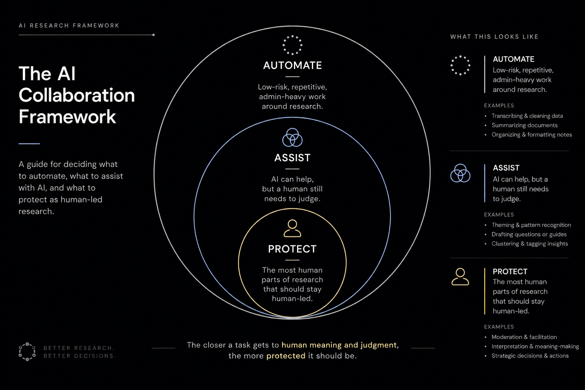

# ux-research-skills



> **Researcher in the Loop.** AI belongs in research — but not everywhere. This repo is built on one
> framework: **Automate** the scaffolding, **Assist** the analysis, **Protect** the human parts that
> only exist in the room. Start with [`research-mode`](research-mode/) — it sets the guardrails every
> other skill inherits.

Reusable UX research skills for **Claude Code** and **Claude.ai**.

Each skill is a self-contained folder with a `SKILL.md`. The same skill works in both
Claude Code (CLI) and Claude.ai (web / desktop / mobile) — the only difference is how you install it.

Skills cover the full research flow: planning, recruitment, interviews, synthesis, reporting, and more.

---

## Skills

### `research-mode` — the guardrails (start here)
Defines where AI belongs in research using the **Automate / Assist / Protect** framework. Fires on
any research request, splits it into tasks, and intervenes with the right friction — doing the
low-risk parts, handing the human-led parts back. Every other skill inherits it.

**Usage:** `/research-mode` at the start of a research session (auto-applied by other skills).

### The research lifecycle

Each skill below inherits `research-mode`'s AAP guardrails and feeds the next:

1. **`research-plan`** — turn a brief into objectives, method, participant criteria, timeline.
2. **`screener`** — turn participant criteria into a qualifying survey.
3. **`recruiting`** — turn screener responses into outreach, tracking, and scheduling.
4. **`discussion-guide`** — turn objectives into a moderated interview / usability-test guide.
5. **`synthesis`** — turn raw transcripts/notes into tagged, clustered themes.
6. **`research-report`** — turn themes into a shareable findings document.
7. **`insight-card`** — package a single decided insight into a shareable card.

Each has its own `SKILL.md` and `README.md` in its folder. Install all of them at once with
`./install.sh`, or upload the individual `.zip` from `dist/` on Claude.ai.

### Reference — outside the lifecycle

### `mobbin-pull`
Pulls curated real-app UI references from Mobbin for a given feature and builds an annotated
research board in Figma. Not part of the plan→insight-card chain — useful for grounding a
`research-plan` or `discussion-guide` in real-world precedent before fielding. Duplicated here from
[`ux-design-skills`](https://github.com/saraeldebissy/ux-design-skills), where it also lives as a
design-workflow tool.

**Usage:** `/mobbin-pull [feature name]`.

---

## Install

### Option A — Claude Code (CLI)

```bash
git clone https://github.com/saraeldebissy/ux-research-skills
cd ux-research-skills
chmod +x install.sh && ./install.sh
```

Skills are copied to `~/.claude/skills/`, available in every project. Re-run `./install.sh`
whenever you pull updates, then start a new Claude Code session to pick them up.

### Option B — Claude.ai (web / desktop / mobile)

1. Turn on the prerequisite first: **Settings → Capabilities → enable Code Execution & File Creation.**
2. Download a bundle from `dist/` → open it on GitHub and click **Download**.
3. **Settings → Capabilities → Skills → Upload skill** → select the `.zip`.
4. Done — type the skill's trigger in any chat.

> On personal / Pro / Max plans, each teammate uploads the `.zip` to their own account.
> When a new version ships, re-download and re-upload.

---

## Requirements

- **Claude Code path:** [Claude Code](https://docs.anthropic.com/en/docs/claude-code) + any MCPs the skill depends on
- **Claude.ai path:** Code Execution + File Creation enabled, plus any connectors the skill needs

---

## Repo layout

```
ux-research-skills/
├── <skill-name>/         # one folder per skill
│   ├── SKILL.md
│   └── README.md
├── dist/
│   └── <name>.zip        # ready-to-upload bundles for Claude.ai
├── install.sh            # copies every skill folder into ~/.claude/skills/
├── CLAUDE.md             # repo context + conventions
└── README.md
```
